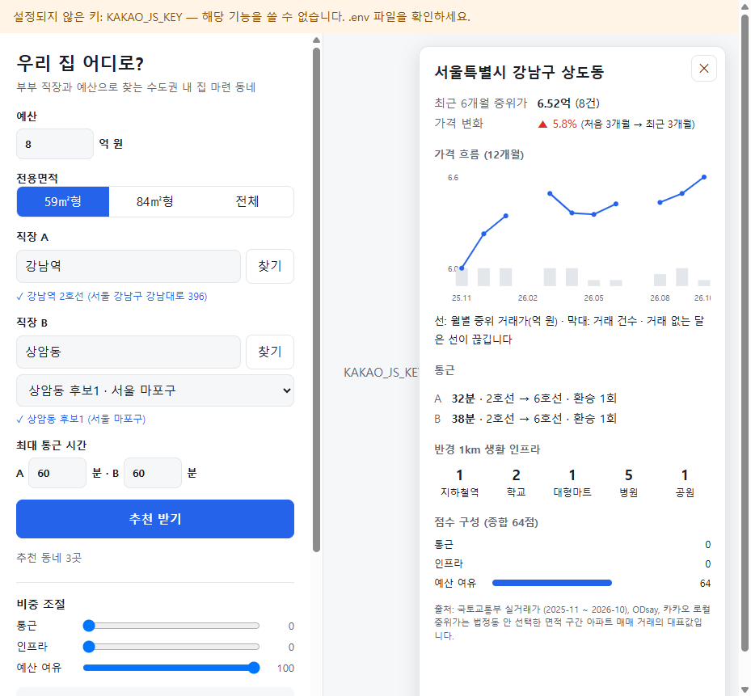

# 🏠 우리 집 어디로?

부부의 직장 두 곳과 매매 예산을 넣으면, **수도권 83개 시·군·구 아파트 실거래가**를 바탕으로
"둘 다 출퇴근이 무난하고, 생활 인프라가 좋고, 예산 안에 드는" 동네(법정동)를 추천하는 데모 웹앱입니다.



> 스크린샷은 가짜 데이터로 띄운 화면입니다. 지도는 `KAKAO_JS_KEY`를 넣으면 표시됩니다.

## 무엇을 보여 주나
- **추천 동네 10곳**: 통근·인프라·예산 여유 점수를 합친 종합 순위 (비중은 슬라이더로 조절)
- **부부 각자의 대중교통 통근 시간**: 소요 시간, 환승 횟수, 노선
- **반경 1km 생활 인프라**: 지하철역, 학교, 대형마트, 병원, 공원 개수
- **가격 흐름**: 12개월 월별 중위 거래가와 거래 건수, 변화율
- 제외된 동네가 있으면 이유와 개수를 숨기지 않고 표시합니다 (거래 부족, 통근 확인 불가 등).

## 추천 방식
1. 국토부 실거래가로 동네별 **최근 6개월 중위가**를 구하고 예산 이하인 곳만 남깁니다 (거래 3건 미만 제외).
2. 두 직장까지 직선거리 합이 짧은 10곳을 고릅니다.
3. ODsay로 10곳 × 2명의 실제 대중교통 시간을 구하고, 최대 통근 시간을 넘는 곳은 뺍니다.
   (ODsay 무료 플랜은 하루 30회라 한 번 검색에 최대 20회만 씁니다. 같은 직장으로 다시 검색하면 30일 캐시로 0회)
4. 남은 곳의 주변 시설을 카카오로 셉니다.
5. 점수 = 통근 50% + 인프라 30% + 예산 여유 20% (통근은 `합계 + 0.5 × 두 사람 차이`로 공평성 반영)

## 필요한 API 키 (모두 무료)

| 환경변수 | 용도 | 발급 |
|---|---|---|
| `DATA_GO_KR_API_KEY` | 아파트 매매 실거래가 | [공공데이터포털](https://www.data.go.kr) → "국토교통부 아파트 매매 실거래가 자료" 활용신청 |
| `ODSAY_API_KEY` | 대중교통 길찾기 | [ODsay LAB](https://lab.odsay.com) 가입 → 서버용 키 발급, 호출 IP 등록 |
| `KAKAO_REST_API_KEY` | 주소 검색, 주변 시설 | [Kakao Developers](https://developers.kakao.com) → 앱 만들기 → REST API 키 |
| `KAKAO_JS_KEY` | 지도 표시 | 같은 앱의 JavaScript 키, 플랫폼 → Web 사이트 도메인에 `http://localhost:8000` 등록 |

`KAKAO_JS_KEY`만 브라우저로 전달되고(도메인 제한으로 보호), 나머지 키는 서버에만 있습니다.

## 실행 방법
> 처음 설치부터 사용법·문제 해결까지 단계별로 정리한 문서: **[실행방법.md](실행방법.md)**

[uv](https://docs.astral.sh/uv/)가 필요합니다 (Python 3.12는 uv가 자동으로 준비합니다).

```bash
git clone <이 저장소 주소>
cd home-finder
cp .env.example .env        # Windows: copy .env.example .env  → 키 4개 입력
uv sync
uv run python -m app.warmup  # 처음 한 번: 실거래가 미리 받기 (약 3~4분)
uv run uvicorn app.main:app  # http://localhost:8000
```

- 공공데이터포털은 초당 호출이 많으면 잠시 막기 때문에, 첫 수집은 일부러 천천히(초당 5회 이하) 받습니다.
- 받은 데이터는 `data/cache.sqlite`에 저장되어 다음부터는 몇 초 안에 결과가 나옵니다.

## 테스트
```bash
uv run pytest            # 단위 테스트 (외부 호출 없음)
uv run pytest -m live    # 실제 API를 1회씩 호출해 응답 형식 확인 (키 필요, 없는 키는 건너뜀)
```

## 한계
- 중위가는 법정동 안에서 선택한 면적 구간 아파트 매매 거래의 대표값이며, 특정 단지 시세가 아닙니다.
- 가격 변화율은 12개월 구간의 처음 3개월과 최근 3개월 중위가를 비교한 값입니다 (약 9개월 간격).
- ODsay 대중교통 길찾기에는 출발 시각 옵션이 없어 출퇴근 시간대 혼잡은 반영되지 않습니다.
- 전세·빌라·오피스텔, 학군 점수, 대출 계산은 포함하지 않습니다.

## 데이터 출처
국토교통부 실거래가 공개시스템(공공데이터포털), ODsay LAB, 카카오 로컬 API.
법정동코드 목록은 [tae0y/real-estate-mcp](https://github.com/tae0y/real-estate-mcp) (MIT)에서 가져왔습니다 — `app/resources/NOTICE.md`.
